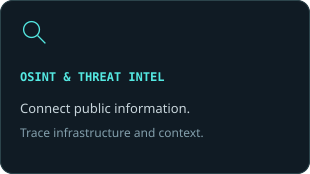
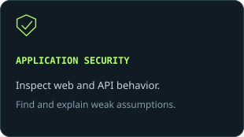
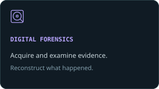
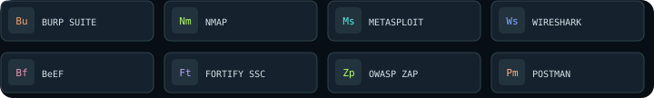
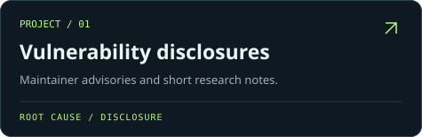
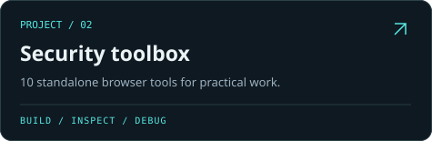
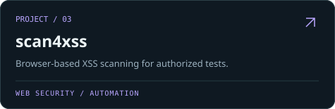
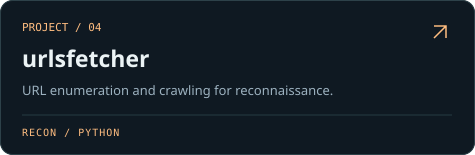

  

  <strong>🛡️ Information Security &nbsp; · &nbsp; 🔎 OSINT &nbsp; · &nbsp; 🧠 Threat Intelligence &nbsp; · &nbsp; 💾 Digital Forensics</strong>

  <a href="https://github.com/hkmj19/open-source-vulnerabilities-pocs"><strong>📂 Public disclosures</strong></a> &nbsp; / &nbsp;
  <a href="https://projects.hemanthkumarmj.com/"><strong>🧰 Security toolbox</strong></a> &nbsp; / &nbsp;
  <a href="https://github.com/hkmj19?tab=repositories"><strong>⚡ Explore my code</strong></a> &nbsp; / &nbsp;
  <a href="https://www.linkedin.com/in/hemanth-kumar-mj-24b50a256/"><strong>💼 LinkedIn</strong></a>

## 👋 Behind the handle

I’m **Hemanth Kumar M J** — a security researcher interested in how systems fail, how information connects, and what digital evidence can tell us.

- 🔬 **Investigate:** software vulnerabilities, web applications, and APIs.
- 🕵️ **Connect:** OSINT, online infrastructure, and threat intelligence.
- 💾 **Examine:** memory, disks, file systems, and forensic artifacts.
- 🛠️ **Build:** practical security tools and reproducible research notes.

  
  
  

### 👨‍💻 Languages

Python · JavaScript · TypeScript · Bash · C · C++ · SQL · HTML/CSS

### ⚙️ Frameworks, databases & environments

FastAPI · React 18 · Flask · Node.js · Neo4j · Redis · SQLite · Docker · WSL2

### 🧰 Security toolkit

### 🛡️ Information security

🔓 **Offensive:** VAPT · Web App & API Penetration Testing · Offensive Security · CTFs  
🔬 **Research:** CVE Research · OSINT · Cyber Threat Intelligence · Malware Analysis  
🔐 **Secure development:** SAST · DAST · SSDLC · OWASP Top 10

### 💾 Digital forensics & incident response

🧪 **Tools:** FTK Imager · Autopsy · Volatility  
🧠 **Analysis:** Memory Analysis · File System Analysis · Artifact Analysis  
💽 **Acquisition:** Disk Imaging · Evidence Acquisition

### 🧅 Dark web, Tor & anonymity networks

🐍 Tor automation with the Python **`stem`** library · Circuit Rotation  
🔎 `.onion` Scraping · Dark Web OSINT  
🛡️ OPSEC-conscious Crawling · No-clearnet-fallback Architectures  
🧅 Tails OS · Anonymity Networks

<strong>🌱 Exploring:</strong> AI Security &nbsp; · &nbsp; Post-Quantum Cryptography

  
  

  
  

Selected maintainer-published advisories crediting **@hkmj19**:

- 🛡️ **[@hapi/inert](https://github.com/hapijs/inert/security/advisories/GHSA-3g2c-3cj7-93hf)** — encoded-path route authentication bypass · **Finder**
- 🔑 **[samlify](https://github.com/tngan/samlify/security/advisories/GHSA-w8r9-gp23-wcxp)** — signing-certificate trust bypass · **Reporter**
- 🧩 **[sanitize-html](https://github.com/apostrophecms/apostrophe/security/advisories/GHSA-c9rx-x947-fp3h)** — unbounded recursion in discarded iframe processing · **Reporter**
- 🐍 **[CodeSafe](https://github.com/Infinitode/CodeSafe/security/advisories/GHSA-7gp8-3j6q-v4h8)** — `safe_eval` sandbox escape through indirect calls · **Reporter**

📖 **[Read the research notes →](https://github.com/hkmj19/open-source-vulnerabilities-pocs)**

